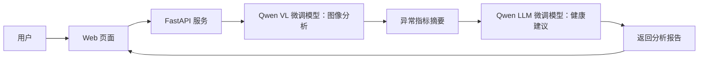

# PHM：私人健康管家（LLM 微调实战）

基于 **Qwen3.5-4B + LoRA（Unsloth）** 微调的医学问答模型与医学报告图像理解模型，并用 **vLLM + FastAPI** 部署成一个简单的 Web 应用：上传医学检测报告图片，自动识别异常指标，并给出健康建议。

> 本项目为编程学习/实战练习，输出内容仅用于演示 API 调用流程，不具备任何医学参考价值，请勿据此做出任何实际健康判断或决策。

## 系统结构



## 技术栈

- 基座模型：Qwen3.5-4B
- 微调框架：Unsloth（LoRA）
- 推理引擎：vLLM
- 服务框架：FastAPI
- 评估工具：EvalScope
- 前端：原生 HTML / CSS / JavaScript

## 目录结构

```
day1/                      # 模型训练与评估
├── 2-prepare-dataset/     # 数据集准备、格式转换、划分
├── 3-eval-llm/            # LLM 评估（1-eval / 2-vllm / 3-app）
├── 4-train-llm/           # LLM LoRA 微调
├── 5-train-vl/            # VL 多模态微调
└── 6-vllm-vl/             # VL 模型验证
day2/                      # 服务部署与应用
├── 1-launch-vllm/         # vLLM 服务启动脚本
├── 2-validation/          # 模型接口验证
└── 3-service/             # 医学检测报告解读服务
    ├── v1/                # 基础文件上传
    ├── v2/                # Base64 图像传输 + 缩放
    ├── v3/                # 接入 vLLM（VL → LLM）
    └── v4/                # 完整 Web UI
```

## 核心流程

1. 用户上传医学检测报告图片
2. VL 模型识别图片中的异常指标并生成摘要
3. LLM 基于摘要生成健康建议
4. 返回完整分析结果并在页面展示

## 运行说明

脚本基于 [uv](https://github.com/astral-sh/uv) 管理依赖，每个子目录自带 `pyproject.toml`，先在对应目录执行 `uv sync` 即可。脚本中的 `/root/autodl-tmp/...` 为作者在 AutoDL 云 GPU 上的模型路径，使用前请改成你自己的路径。

## 仓库未包含的内容

为保持仓库轻量，以下内容没有上传：`uv.lock`（可用 `uv sync` 重新生成）、原始问答数据集压缩包、训练/测试用医学图片、NLTK 数据包，以及开发时的原型截图。

## 免责声明

模型输出可能存在错误、偏差，甚至与问题完全无关。请勿根据模型输出做出任何实际的健康判断或决策。
